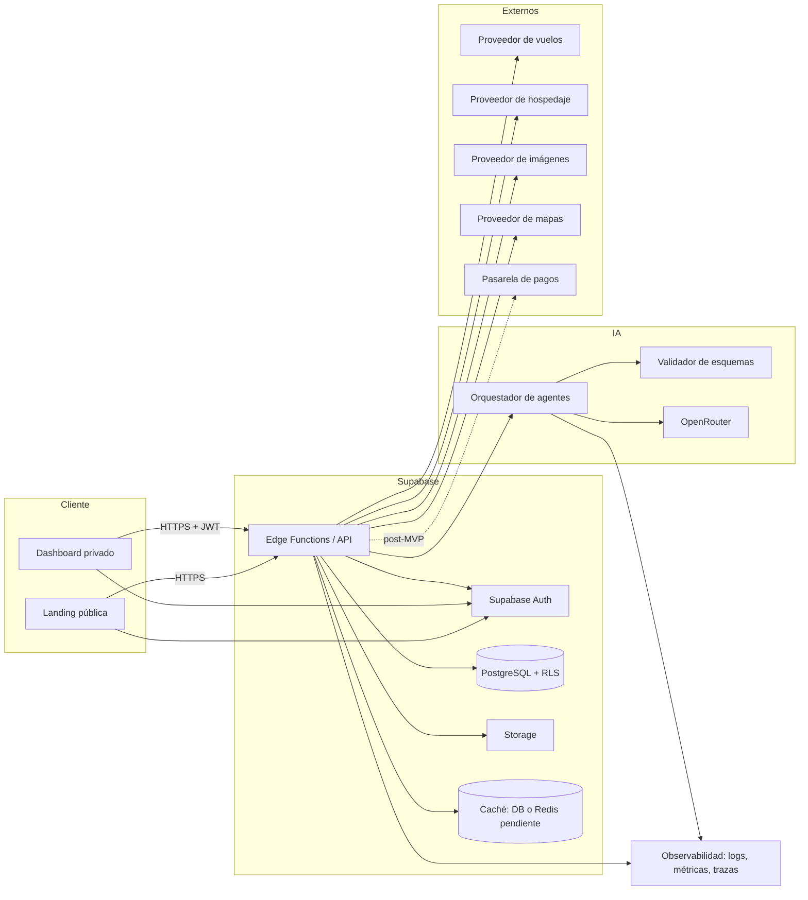

# CORE-02 — Arquitectura del sistema

- **ID:** `CORE-02`
- **Nombre:** Arquitectura actual y arquitectura objetivo
- **Estado:** `APPROVED`
- **Versión:** `0.2.0`
- **Fecha:** 2026-10-21
- **Fuente:** Documento Maestro DestinoSmart v4.0; `docs/tech-stack.md`; `docs/current-architecture-audit.md`; `docs/constitution.md`; `ADR-001`; `ADR-002`.
- **Aprobación:** aprobada por el propietario del proyecto — `approved_by: propietario del proyecto`, `approved_at: 2026-10-21`, `approved_version: 0.2.0`.
- **Objetivo:** describir con fidelidad la arquitectura existente, delimitar la arquitectura objetivo y establecer responsabilidades, flujos, límites y decisiones pendientes sin autorizar migraciones.

## 1. Alcance

Esta especificación cubre:

- La arquitectura **actual** comprobada en `prototipos/`.
- La arquitectura **objetivo** derivada de v4.0 y del stack fijado.
- La delimitación de responsabilidades entre frontend, Supabase, Edge Functions, orquestador de IA, adaptadores externos, caché y observabilidad.
- Los flujos de información principales.
- La preservación de los prototipos existentes.

No cubre:

- Implementación, migraciones, despliegues ni contratos ejecutables.
- Selección de hosting, bundler, router, caché o proveedores no aprobados.
- Diseño detallado de agentes (ver `CORE-08`).
- Modelo de datos detallado (ver `CORE-04`).

## 1.1 Restricciones

- No se migran, fusionan ni reescriben los prototipos.
- No se decide hosting, routing, bundler, caché ni proveedores en este documento.
- No se implementan Edge Functions, auth, IA ni colas.
- No se crea infraestructura duplicada.
- No se exponen secretos ni `service_role`.
- Las decisiones transversales requieren ADR y aprobación humana.

## 2. Arquitectura actual (IMPLEMENTADO)

### 2.1 Vista general

```text
prototipos/
├── prototipo-claude/          SPA Vite + React + TS + Tailwind + Framer
│   └── Landing A (paleta ocean/sunset/gold, Fraunces)
├── prototipo-gpt/             SPA Vite + React + TS + Tailwind + Framer
│   └── Landing B (tokens brand.*, Plus Jakarta Sans)
└── destinosmart-dashboard/    SPA Vite + React + TS + Tailwind + Framer
    └── Dashboard de usuario (datos demo, callbacks opcionales)
```

- No hay aplicación integrada, routing, backend, autenticación, base de datos ni servicios.
- No hay puntos de entrada compartidos ni paquete de Design System.
- Los datos son **hardcodeados** o viven en `useState`.
- Las integraciones externas se limitan a Google Fonts, imágenes remotas de Unsplash y un enlace a Google Maps.
- No hay observabilidad, tests, CI ni control de versiones.

**Evidencia:** `docs/current-architecture-audit.md`, secciones 3–10.

### 2.2 Consecuencia arquitectónica

Los prototipos son **material de referencia visual y de interacción**, no una base de producción. Cualquier evolución hacia la arquitectura objetivo requiere una fase de implementación autorizada, con spec, plan, tareas y pruebas.

## 3. Principios arquitectónicos

1. **Especificación antes que código** (constitución, Artículo I).
2. **Separación de responsabilidades**: UI, API, dominio, IA, adaptadores y datos con límites explícitos.
3. **Servidor como autoridad** para auth, permisos, cuotas, rate limits y validación.
4. **Integraciones desacopladas** mediante adaptadores; ningún proveedor acoplado al dominio.
5. **IA validada**: salidas tipadas, límites de costo/tokens, timeouts, fallbacks y observabilidad.
6. **Mobile-first y accesibilidad** desde el diseño.
7. **Trazabilidad** de requisitos, decisiones, cambios y pruebas.
8. **Evolución incremental**: vertical slices, sin microservicios prematuros.
9. **Preservación de prototipos**: no migrar, fusionar ni reescribir sin autorización.

## 4. Arquitectura objetivo (PROPUESTO / DOCUMENTADO)

### 4.1 Vista lógica



> El diagrama es conceptual. No define hosting, router, bundler, colas, cache concreto ni topología de despliegue.

### 4.2 Capas y responsabilidades

| Capa / componente | Responsabilidad | No debe hacer | Estado |
|---|---|---|---|
| **Web client** (landing + dashboard) | Render, accesibilidad, validación de UX, llamadas al API, estados loading/error/empty. | Autorizar, calcular cuotas, guardar secretos, decidir precios. | `PROPUESTO` |
| **Supabase Auth** | Registro, login, sesión, recuperación, verificación, JWT. | Lógica de negocio. | `DOCUMENTADO` |
| **Edge Functions / API** | Validación de requests, auth, autorización, cuotas, idempotencia, orquestación, PDF, ofertas. | Render de UI, acceso directo a secretos desde el cliente. | `DOCUMENTADO` |
| **Dominio** (módulos internos) | Reglas de viaje, presupuesto, itinerario, ofertas, cuotas, exportación. | Depender de un proveedor concreto. | `PROPUESTO` |
| **Orquestador IA** | Clasificar intención, seleccionar agentes, componer contexto, validar salidas. | Exponerse directamente a Internet. | `PROPUESTO` |
| **Adaptadores de proveedores** | Traducir APIs externas a contratos internos. | Filtrar reglas de negocio. | `PROPUESTO` |
| **PostgreSQL + RLS** | Persistencia transaccional, integridad, aislamiento por usuario. | Ser la única capa de autorización si hay errores de API. | `DOCUMENTADO` |
| **Servicio de autorización central** | Resolver permisos por usuario, plan y viaje; crédito Free; vigencia Pro; acceso premium. | Duplicar reglas en el cliente o en cada endpoint. | `PROPUESTO` |
| **Subsistema de suscripciones** | Planes, períodos, activación, cancelación y derechos. | Conceder permisos desde el frontend. | `PROPUESTO` |
| **Ciclo de vida de viajes** | Crear, consumir crédito, activar Pro, vencer, solo lectura y archivar. | Permitir viajes Free ilimitados. | `PROPUESTO` |
| **Storage** | PDFs, imágenes propias, artefactos temporales. | Guardar secretos o PII innecesaria. | `DOCUMENTADO` |
| **Caché** | Ofertas, datos de lectura frecuente, resultados permitidos. | Guardar PII, tokens o datos financieros sensibles. | `PENDIENTE` (`DQ-13`) |
| **Observabilidad** | Logs estructurados, métricas, trazas, alertas. | Registrar PII, prompts completos o secretos. | `PROPUESTO` |

## 5. Delimitación de dominios

| Dominio | Responsabilidad | Datos propios | Depende de |
|---|---|---|---|
| **Identidad y acceso** | Usuarios, sesiones, planes, entitlements. | `profiles`, `subscriptions`, `usage_*` | Supabase Auth |
| **Autorización Freemium** | Resolver si el usuario puede crear viaje, consumir crédito, acceder a Pro o solo lectura. | `free_trip_credits`, `trips.is_free_trial_trip`, `trips.free_pro_expires_at`, `subscription_events` | Identidad, datos |
| **Planificación** | Formulario, validación, viaje, presupuesto, itinerario. | `trips`, `budgets`, `itineraries` | IA, autorización |
| **Ofertas** | Rutas, precios, imágenes, frescura, refresco. | `offers`, `offer_refresh_*` | Proveedores, caché |
| **Exportación** | PDF y artefactos. | `exports` | Storage, planificación |
| **IA** | Orquestación, prompts, validación, evaluación. | `ai_runs`, `prompt_versions` | OpenRouter |
| **Pagos y reservas** (post-MVP) | Checkout, reservas, conciliación. | `bookings`, `payments` | Pasarela, proveedores |
| **Observabilidad** | Métricas, logs, trazas, alertas. | Telemetría | Todos |

## 6. Flujos de información

### 6.1 Autenticación

1. El cliente inicia sesión con Supabase Auth.
2. Supabase devuelve un JWT y un refresh token gestionado por el SDK.
3. El cliente envía el JWT en `Authorization: Bearer`.
4. El Edge Function verifica el JWT y extrae `sub`/rol.
5. El servidor consulta plan/entitlement y aplica RLS.
6. El cliente nunca recibe `service_role`.

### 6.2 Generación de plan (MVP)

1. El usuario envía el formulario.
2. El cliente valida UX y llama a `POST /v1/trips` con `Idempotency-Key`; el backend crea el viaje y consume el crédito Free de forma atómica si aplica.
3. El cliente llama a `POST /v1/planning/generate` con `trip_id` e `Idempotency-Key`.
4. El Edge Function valida esquema, auth, acceso del viaje, cuota y duplicados.
5. El orquestador construye contexto y ejecuta los agentes de presupuesto e itinerario.
6. El validador comprueba los esquemas; si falla, reintenta o devuelve error controlado.
7. El servidor persiste presupuesto, itinerario y `ai_run` en una operación consistente.
8. Se descuenta la cuota de IA de forma atómica; el crédito Free no se vuelve a tocar.
9. Se devuelve el plan con `estimate: true`, fuentes y disclaimers.
10. Si el tiempo excede el presupuesto, se devuelve `202` con `job_id` y el cliente consulta el estado.

### 6.3 Ofertas

1. Un mecanismo programado (PROPUESTO; `DQ-15`) consulta proveedores cada 6 horas.
2. Normaliza, valida y guarda seis ofertas con `observed_at`/`expires_at`.
3. La landing lee ofertas vigentes desde caché/DB.
4. El refresco manual pasa por `POST /v1/offers/refresh`.
5. El servidor aplica el límite de 15 minutos por sujeto y devuelve `429` con `Retry-After` si no procede.
6. Si el proveedor falla, se conserva la última oferta válida y se marca `stale`.

### 6.4 Exportación PDF

1. El cliente solicita `POST /v1/exports` con `trip_id`.
2. El servidor verifica propiedad, plan y estado del viaje.
3. Genera el PDF con presupuesto e itinerario consistentes.
4. Guarda el artefacto en Storage con expiración.
5. Devuelve una URL firmada o descarga.
6. Registra el evento y el resultado.

### 6.5 Cuotas

1. El servidor identifica al sujeto (usuario o anónimo, según `DQ-05`).
2. Verifica entitlement y período.
3. Reserva/consume la cuota de forma atómica antes de una operación costosa.
4. Si la operación falla de forma recuperable, aplica la política de devolución definida.
5. Registra `usage_event` con idempotencia.
6. Devuelve `429`/`403` cuando corresponde.

### 6.6 Post-MVP: chat, reservas y pagos

- **Chat:** cliente → Edge → orquestador → OpenRouter; historial aislado por usuario; gating por plan.
- **Reservas:** cliente → Edge → adaptador de reservas → proveedor; validación estricta, idempotencia y confirmación.
- **Pagos:** checkout hospedado por la pasarela; webhooks firmados; conciliación; nunca almacenar datos de tarjeta.

### 6.7 Ciclo de vida Freemium y autorización central

```mermaid
sequenceDiagram
  participant U as Usuario
  participant API as Edge Function / API
  participant AZ as Servicio de autorización
  participant DB as PostgreSQL

  U->>API: POST /v1/trips (Idempotency-Key)
  API->>AZ: authorizeCreateTrip(user, payload)
  AZ->>DB: lock profile + leer credits/plan
  alt Free con crédito
    AZ-->>API: allow(free_trip=true)
    API->>DB: BEGIN
    API->>DB: insert trip (is_free_trial_trip=true,
      free_pro_expires_at=created_at+30d)
    API->>DB: decrement free_trip_credits
    API->>DB: insert credit_event(consumed)
    API->>DB: COMMIT
    API-->>U: 201 trip + access=pro
  else Free sin crédito
    AZ-->>API: deny(FREE_TRIP_LIMIT_REACHED)
    API-->>U: 403/429 + paywall
  else Suscripción activa
    AZ-->>API: allow(unlimited=true)
    API->>DB: insert trip
    API-->>U: 201 trip + access=pro
  end
```

**Reglas arquitectónicas:**

- La autorización se resuelve en un único servicio/capa; los endpoints no replican reglas.
- La creación del viaje y el consumo del crédito ocurren en la misma transacción.
- `free_pro_expires_at` se calcula con el reloj del backend: `created_at + interval '30 days'`.
- Un usuario Free sin crédito no puede crear un segundo viaje, aunque manipule React o llame directo al API.
- El acceso premium se evalúa por **viaje**: un viaje Free puede ser Pro mientras `now() < free_pro_expires_at`; un viaje vencido es solo lectura.
- Una suscripción activa permite viajes ilimitados; las cuotas de IA se resolverán en el servicio de cuotas.
- El cliente recibe un resumen de acceso (`can_create_trip`, `can_use_ai`, `can_export_pdf`, `can_chat`, `can_book`, `read_only`) y lo usa solo para UI.
- Los errores de autorización usan códigos estables (`FREE_TRIP_LIMIT_REACHED`, `FREE_PRO_EXPIRED`, `SUBSCRIPTION_REQUIRED`, `TRIP_READ_ONLY`, `FORBIDDEN`, `UNAUTHENTICATED`).

## 7. Propiedad y consistencia de datos

| Dato | Fuente de verdad | Consistencia | Notas |
|---|---|---|---|
| Usuario/sesión | Supabase Auth | Fuerte | `auth.users`; perfil en `profiles`. |
| Plan/entitlement | PostgreSQL | Fuerte | Cambios por servidor/webhook. |
| Viaje, presupuesto, itinerario | PostgreSQL | Fuerte | Transacción al generar. |
| Ofertas | PostgreSQL/caché | Eventual | TTL 6 h; stale permitido con etiqueta. |
| Cuotas | PostgreSQL | Fuerte | Incremento atómico; idempotencia. |
| PDF | Storage + metadatos | Fuerte para metadatos; eventual para artefacto | URL firmada y expiración. |
| AI runs | PostgreSQL | Fuerte | Metadatos; no PII innecesaria. |
| Reservas/pagos | PostgreSQL + proveedor | Fuerte/conciliable | Post-MVP; idempotencia y webhooks. |

**Reglas:**

- El cliente no es fuente de verdad.
- La caché es derivada y reconstruible.
- Las operaciones costosas y financieras son idempotentes.
- Las fechas se almacenan como `YYYY-MM-DD`; los timestamps en UTC.
- Los importes llevan moneda ISO 4217 y no se mezclan en una misma operación.

## 8. Límites de confianza y seguridad

| Límite | Riesgo | Control |
|---|---|---|
| Navegador → API | Manipulación de requests, replay, abuso | Validación server-side, JWT, idempotencia, rate limit. |
| API → OpenRouter | Fuga de datos, prompt injection, costo | Minimización, delimitadores, schema, límites, timeout. |
| API → proveedores | Datos falsos, indisponibilidad, costos | Adaptadores, validación, timeouts, circuit breaker. |
| API → DB | IDOR, escalada, fugas | RLS, ownership, service role solo servidor. |
| Webhooks → API | Suplantación, replay | Firma, timestamp, idempotencia, allowlist. |
| Logs → terceros | PII/secretos | Redacción, retención, acceso restringido. |

## 9. Entornos y despliegue

| Entorno | Propósito | Estado |
|---|---|---|
| Local | Desarrollo y pruebas con Supabase local/mocks. | `PENDIENTE` |
| CI | Lint, typecheck, tests, contratos, escaneo de secretos. | `PENDIENTE` |
| Staging | Validación con datos sintéticos y sandboxes. | `PENDIENTE` |
| Producción | Usuarios reales; secretos separados. | `PENDIENTE` |

**Decisiones abiertas:** hosting web, región Supabase, estrategia de previews, gestión de secretos, CI/CD y observabilidad (`DQ-01`, `DQ-17`).

## 10. Correspondencia actual → objetivo

| Actual | Objetivo | Acción autorizada |
|---|---|---|
| 3 SPAs Vite | 1 app web pública/privada | **Ninguna en esta fase** |
| Sin routing | Routing por definir | **Pendiente** |
| Datos demo | PostgreSQL + RLS | **Pendiente** |
| Sin auth | Supabase Auth | **Pendiente** |
| Sin backend | Edge Functions | **Pendiente** |
| Sin IA | Orquestador + OpenRouter | **Pendiente** |
| Sin caché | DB/Redis por decidir | **Pendiente** |
| `window.print()` | Exportación PDF dedicada | **Pendiente** |
| Sin tests/CI | Estrategia `CORE-09` | **Pendiente** |

## 11. Preservación de los prototipos

- Los prototipos **no se migran, fusionan, refactorizan ni eliminan** en esta fase.
- Cualquier reutilización futura requiere una decisión de baseline (`D-01`) y una tarea autorizada.
- Las diferencias visuales y de contrato se documentan en `CORE-06` y en la auditoría.
- No se crea una infraestructura duplicada sin aprobación.

## 12. Requisitos

| ID | Requisito | Fuente |
|---|---|---|
| `CORE-02-FR-001` | Separar landing pública y dashboard privado con controles de acceso distintos. | RF-01; v4.0 §3; RF-08 como prerequisito |
| `CORE-02-FR-002` | Toda operación sensible debe pasar por Edge Functions/servidor. | RNF-04 |
| `CORE-02-FR-003` | El servidor debe validar auth, permisos, cuotas e idempotencia antes de operaciones costosas. | RF-08 |
| `CORE-02-FR-004` | La IA debe estar aislada detrás de un orquestador y adaptadores. | RF-02, RF-03 |
| `CORE-02-FR-005` | Las ofertas deben servirse desde caché con TTL y refresco controlado. | RF-04 |
| `CORE-02-FR-006` | La exportación PDF debe generarse en servidor y entregarse con acceso controlado. | RF-06 |
| `CORE-02-FR-007` | Las operaciones largas deben soportar modo asíncrono con estado consultable. | RNF-03 |
| `CORE-02-FR-008` | Los proveedores externos deben estar detrás de adaptadores sustituibles. | RNF-04 |
| `CORE-02-FR-009` | La observabilidad debe cubrir API, IA, cuotas y ofertas sin PII. | RNF-05 |
| `CORE-02-FR-010` | La arquitectura debe preservar los prototipos existentes. | Instrucción del propietario |
| `CORE-02-FR-011` | La autorización de viajes, crédito y acceso Pro debe resolverse en un servicio central. | BR-FREE-010 |
| `CORE-02-FR-012` | El primer viaje Free debe crear viaje, consumir crédito y fijar vencimiento en una transacción atómica. | BR-FREE-002/004 |
| `CORE-02-FR-013` | El acceso premium debe evaluarse por viaje y por vigencia, no solo por plan del usuario. | BR-FREE-003/007 |
| `CORE-02-FR-014` | Una suscripción activa debe permitir viajes ilimitados; las cuotas IA quedan en el servicio de cuotas. | BR-FREE-008 |

### No funcionales

| ID | Requisito | Fuente |
|---|---|---|
| `CORE-02-NFR-001` | TypeScript estricto y componentes desacoplados. | RNF-01 |
| `CORE-02-NFR-002` | Latencia y disponibilidad medibles. | RNF-03, RNF-05 |
| `CORE-02-NFR-003` | Escalabilidad horizontal del API serverless. | RNF-05 |
| `CORE-02-NFR-004` | Mantenibilidad y bajo acoplamiento. | Constitución |
| `CORE-02-NFR-005` | Seguridad por diseño y mínimo privilegio. | RNF-04 |

## 13. Criterios de aceptación

### `CORE-02-AC-001` → `CORE-02-FR-001`
- **Given** un visitante sin sesión,
- **When** intenta acceder a un viaje privado,
- **Then** el servidor rechaza la operación y no revela datos.

### `CORE-02-AC-002` → `CORE-02-FR-002`, `CORE-02-FR-003`
- **Given** una solicitud de generación,
- **When** el cliente intenta omitir una cuota o falsear un plan,
- **Then** el servidor aplica la cuota real y rechaza la operación.

### `CORE-02-AC-003` → `CORE-02-FR-004`
- **Given** una solicitud de plan,
- **When** el orquestador falla o devuelve un esquema inválido,
- **Then** el sistema devuelve un error controlado y no persiste datos corruptos.

### `CORE-02-AC-004` → `CORE-02-FR-005`
- **Given** ofertas cacheadas,
- **When** un usuario solicita refresco dentro de 15 minutos,
- **Then** el servidor responde con el tiempo restante y no consulta al proveedor.

### `CORE-02-AC-005` → `CORE-02-FR-006`
- **Given** un viaje de otro usuario,
- **When** se solicita su PDF,
- **Then** el servidor deniega el acceso.

### `CORE-02-AC-006` → `CORE-02-FR-007`
- **Given** una generación que excede el tiempo síncrono,
- **When** el servidor responde `202`,
- **Then** el cliente puede consultar el estado y obtener el resultado o un error.

### `CORE-02-AC-007` → `CORE-02-FR-008`
- **Given** un proveedor externo no disponible,
- **When** se ejecuta una operación,
- **Then** el adaptador devuelve un error normalizado y el sistema no filtra detalles del proveedor.

### `CORE-02-AC-008` → `CORE-02-FR-010`
- **Given** una propuesta de cambio arquitectónico,
- **When** implica migrar o fusionar prototipos,
- **Then** se bloquea hasta contar con aprobación explícita y ADR.

### `CORE-02-AC-009` → `CORE-02-FR-009`
- **Given** una operación de API, IA, cuota u oferta,
- **When** se ejecuta,
- **Then** produce telemetría correlacionada sin PII y permite reconstruir el flujo.

### `CORE-02-AC-010` → `CORE-02-NFR-004`
- **Given** una revisión de arquitectura,
- **When** se inspeccionan dependencias entre dominio, API, IA y adaptadores,
- **Then** no hay ciclos ni acoplamiento directo a un proveedor.

### `CORE-02-AC-011` → `CORE-02-FR-011`
- **Given** una operación de creación de viaje o acceso premium,
- **When** se ejecuta,
- **Then** la decisión proviene del servicio central de autorización, no de React.

### `CORE-02-AC-012` → `CORE-02-FR-012`
- **Given** un Free con crédito,
- **When** crea su primer viaje,
- **Then** viaje, consumo de crédito, marca de viaje gratuito y `free_pro_expires_at` se confirman en una sola transacción.

### `CORE-02-AC-013` → `CORE-02-FR-013`
- **Given** un viaje Free vencido,
- **When** se solicita una operación premium,
- **Then** el servicio de autorización devuelve `FREE_PRO_EXPIRED`/`TRIP_READ_ONLY` y no ejecuta la operación.

### `CORE-02-AC-014` → `CORE-02-FR-014`
- **Given** una suscripción paga activa,
- **When** el usuario crea viajes,
- **Then** la creación no se limita por el crédito Free; las cuotas IA se evalúan por separado.

## 13.1 Matriz de cobertura FR/NFR → AC

| Requisito | AC | Estado |
|---|---|---|
| `CORE-02-FR-001` | `CORE-02-AC-001` | Cubierto |
| `CORE-02-FR-002` | `CORE-02-AC-002` | Cubierto |
| `CORE-02-FR-003` | `CORE-02-AC-002` | Cubierto |
| `CORE-02-FR-004` | `CORE-02-AC-003` | Cubierto |
| `CORE-02-FR-005` | `CORE-02-AC-004` | Cubierto |
| `CORE-02-FR-006` | `CORE-02-AC-005` | Cubierto |
| `CORE-02-FR-007` | `CORE-02-AC-006` | Cubierto |
| `CORE-02-FR-008` | `CORE-02-AC-007` | Cubierto |
| `CORE-02-FR-009` | `CORE-02-AC-009` | Cubierto |
| `CORE-02-FR-010` | `CORE-02-AC-008` | Cubierto |
| `CORE-02-FR-011` | `CORE-02-AC-011` | Cubierto |
| `CORE-02-FR-012` | `CORE-02-AC-012` | Cubierto |
| `CORE-02-FR-013` | `CORE-02-AC-013` | Cubierto |
| `CORE-02-FR-014` | `CORE-02-AC-014` | Cubierto |
| `CORE-02-NFR-001` | `CORE-03-AC-001`, `CORE-09-AC-001` | Cubierto por stack y pruebas. |
| `CORE-02-NFR-002` | `CORE-10-AC-001`, `CORE-10-AC-003` | Cubierto por medición. |
| `CORE-02-NFR-003` | `CORE-10-AC-001` | **Parcial**: requiere prueba de carga dedicada. |
| `CORE-02-NFR-004` | `CORE-02-AC-010` | Cubierto |
| `CORE-02-NFR-005` | `CORE-05-AC-002`, `CORE-05-AC-003` | Cubierto por seguridad. |

## 14. Dependencias

- `CORE-01`, `CORE-03`, `CORE-04`, `CORE-05`, `CORE-07`, `CORE-08`, `CORE-09`, `CORE-10`.
- `BR-FREE-001` a `BR-FREE-010`; Features 04 (planes/cuotas) y 07 (dashboard/acceso).
- `DQ-01`, `DQ-03`, `DQ-04`, `DQ-09`, `DQ-11`, `DQ-12`, `DQ-13`, `DQ-15`, `DQ-17`, `DQ-19`, `DQ-21`.

## 15. Riesgos

| ID | Riesgo | Impacto | Mitigación propuesta |
|---|---|---|---|
| `CORE-02-RISK-001` | Sobrearquitectura prematura. | Alto | Vertical slices; no microservicios. |
| `CORE-02-RISK-002` | Acoplamiento a OpenRouter o a un proveedor. | Alto | Adaptadores y contratos. |
| `CORE-02-RISK-003` | Cold starts/latencia de Edge Functions. | Medio | Medición, timeouts, async fallback. |
| `CORE-02-RISK-004` | Cache stampede en ofertas. | Medio | Lock distribuido/TTL jitter. |
| `CORE-02-RISK-005` | Fuga de `service_role`. | Alto | Secretos server-side, rotación, revisión. |
| `CORE-02-RISK-006` | Inconsistencia entre viaje, presupuesto e itinerario. | Alto | Transacción/idempotencia. |
| `CORE-02-RISK-007` | Duplicación de infraestructura por los tres prototipos. | Alto | Baseline único cuando se autorice. |
| `CORE-02-RISK-008` | Dependencia de un hosting no decidido. | Medio | ADR antes de desplegar. |
| `CORE-02-RISK-009` | Autorización duplicada o solo en React. | Alto | Servicio central + pruebas server-side. |
| `CORE-02-RISK-010` | Crédito Free consumido fuera de transacción. | Alto | RPC/Edge transaccional + idempotencia. |

## 16. Decisiones pendientes

| ID | Decisión | Bloquea |
|---|---|---|
| `CORE-02-DQ-001` | Hosting y despliegue web. | Infraestructura. |
| `CORE-02-DQ-002` | Routing de producción. | Frontend. |
| `CORE-02-DQ-003` | Caché DB vs Redis vs híbrida (`DQ-13`). | Ofertas. |
| `CORE-02-DQ-004` | Cola/ejecución asíncrona para generaciones largas. | RNF-03. |
| `CORE-02-DQ-005` | Proveedores reales (`DQ-09`). | Ofertas, reservas. |
| `CORE-02-DQ-006` | Modelos y fallback de IA (`DQ-19`). | IA. |
| `CORE-02-DQ-007` | Región Supabase y retención (`DQ-17`). | Datos. |
| `CORE-02-DQ-008` | Baseline de prototipos (`D-01`). | Implementación futura. |
| `CORE-02-DQ-009` | Estimaciones/cotizaciones y TTL (`DQ-04`). | Ofertas/presupuestos. |
| `CORE-02-DQ-010` | Origen de rutas y alcance del refresco (`DQ-12`). | Ofertas. |
| `CORE-02-DQ-011` | Mecanismo del cron de 6 h (`DQ-15`). | Ofertas. |

## 17. Referencias

- `DestinoSmart v4.0.pdf` — secciones 3, 5, 6.
- `docs/tech-stack.md`
- `docs/constitution.md`
- `docs/current-architecture-audit.md`
- `docs/decisions/ADR-001-mvp-stack.md`
- `docs/decisions/ADR-002-product-name.md`
- `specs/core/README.md`
- `CORE-04`, `CORE-05`, `CORE-07`, `CORE-08`, `CORE-09`, `CORE-10`
