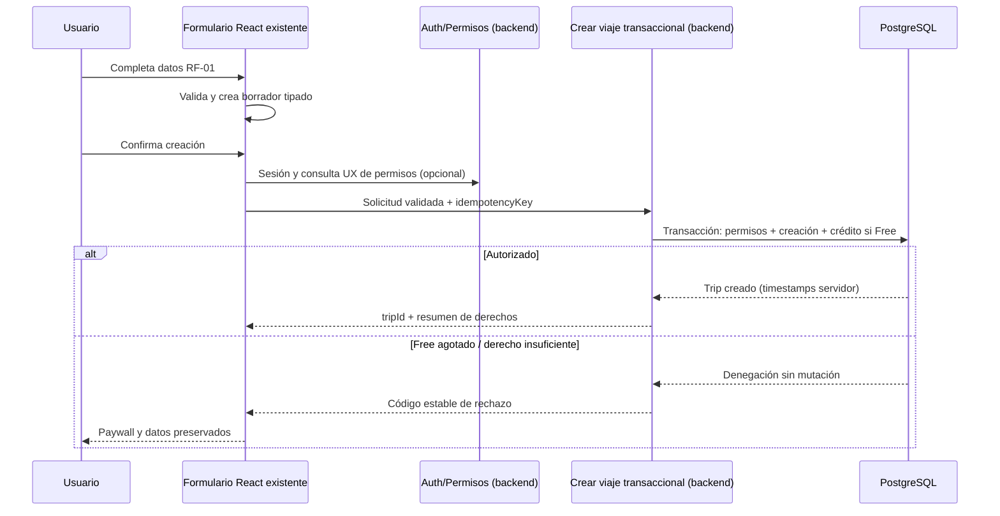

# Feature 03 — Formulario inteligente de viaje | Plan técnico

- **feature_id:** `03-travel-form`
- **version:** `0.3.0`
- **status:** `draft`
- **approved_by / approved_at:** `— / —`
- **input:** `spec.md` v0.3.0 y `clarifications.md` v0.1.0; documento maestro DestinoSmart v4.0 + Freemium (CR-003/ADR-002, 2026-10-21).
- **gate:** G0 satisfecho; G1/G2 pendientes. G2 requiere G1 aprobado, auditoría read-only y aprobación del plan.

## 1. Objetivo y reglas arquitectónicas
Preparar una integración incremental, trazable y reversible del formulario RF-01 reutilizando `prototipos/prototipo-gpt` (Landing Page, hero, formulario, Design System, routing, componentes y dashboard avanzado) **sin reemplazar ni rediseñar**. El frontend objetivo es React + TypeScript estricto, Tailwind y Framer Motion; la auditoría read-only confirmará versiones/rutas reales antes de cualquier diff. Supabase Edge Functions/IA y creación de viajes no se implementan en esta feature.

### Regla de precedencia
1. Autorización expresa del propietario y constitución SDD.
2. Repositorio como evidencia de infraestructura y UI existentes.
3. PDF v4.0 como fuente del comportamiento deseado.
4. Este plan como propuesta técnica todavía pendiente.

Si una discrepancia exige migrar, instalar librerías, alterar tokens o reorganizar componentes: **detenerse, registrar hallazgo y proponer ADR**, no ejecutar.

## 2. Preflight obligatorio (solo lectura)
- Leer `AGENTS.md`, `docs/constitution.md`, `MEMORY.md`, `docs/tech-stack.md`, `docs/open-questions.md` y las specs core disponibles.
- Localizar en `prototipos/prototipo-gpt` el hero/formulario (`TravelForm`, `DesktopTripSearch`, `MobileTripChat`), componentes, tokens, dashboard (`UserDashboard`), routing, scripts y tests.
- Revisar Feature 02 para compatibilidad de autenticación y Feature 04 para cuotas (sin construir ninguna).
- Obtener el estado de git y la lista base de archivos protegidos.
- Identificar contratos de API existentes, no suponer su ausencia.
- Generar una tabla de impacto `archivo → uso → cambio solicitado → riesgo` antes de cualquier edición.
- Verificar que los comandos de test/typecheck existen; no instalar ni configurar herramientas solo para cumplir este plan.

## 3. División modular propuesta (no rutas ni nombres de archivos obligatorios)
| Responsabilidad | Diseño objetivo | Reutilización preferida |
|---|---|---|
| Presentación | Formulario embebido en hero, entradas, selección y errores | Controles/tokens/layouts actuales |
| Estado | Un solo estado tipado para borrador y selecciones | Hooks/store/Form library existente |
| Validación | Funciones o esquemas centralizados sin lógica duplicada | Validador instalado; si no existe, proponer opción sin instalar |
| Normalización | Transformar vista en `TravelSearchRequest` estable | Utilidades existentes |
| Adaptador de envío | Punto único de integración con endpoint aprobado | Cliente HTTP/routing existente |
| Estados | idle/editing/validating/submitting/success/error (si aplica) | Sistema visual actual de mensajes/loading |
| Pruebas | Funciones puras, integración de UI, E2E mínimo | Herramientas disponibles en repositorio |

**No crear** una nueva app, routing, librería de formularios, design system, service/backend ni base de datos como requisito implícito.

## 4. Datos y contratos de frontera
Especificación del borrador en `spec.md`, §10. **Decisión:** origen/destino como `{id,label}`; fechas de inicio/fin tentativas; adultos/menores; presupuesto positivo ISO 4217; USD por defecto según prototipo; cinco servicios; «all» no se persiste. El catálogo de ubicaciones, edades/límites, moneda final y timezone quedan pendientes non-blocking y no se inventan.

Interfaz tentativa **solo para análisis**:
```ts
type TravelService =
  | 'flights' | 'accommodation' | 'local_transport' | 'attractions' | 'restaurants';

type TravelSearchRequest = {
  origin: { id: string; label: string; kind?: 'city' | 'airport' };
  destination: { id: string; label: string; kind?: 'city' | 'airport' };
  dates: { start: string; end: string };
  travelers: { adults: number; minors: number };
  services: TravelService[];
  targetBudget?: { amount: string; currency: string };
  currency: string;
};
```
Este contrato NO define endpoint, catálogo de ubicaciones ni límites definitivos. Cualquier contrato implementado debe ser aprobado, validado en frontera y versionado si ya hay consumidores. La auditoría debe mapear `TravelSearch`/`ServiceId` del prototipo (`stays`, `transport`, `food`) al contrato normalizado y decidir si se conserva un adaptador; no modificar el prototipo.

## 5. Secuencia conceptual
1. El usuario edita controles reutilizados.
2. UI sincroniza borrador tipado; `select all` deriva del conjunto de cinco servicios.
3. Al intentar continuar, validación client-side muestra errores accesibles.
4. Payload se normaliza sin inventar precios ni consultar IA.
5. Si existe receptor **aprobado**, valida también en servidor, aplica autenticación/cuota si procede y responde; si no, la UI no anuncia éxito de generación.
6. Ante fallo, se conserva el borrador cuando es seguro; usuario puede corregir y reintentar.

## 6. Política de validación propuesta y pendientes
- Origen/destino: referencias normalizadas requeridas; catálogo/proveedor pendiente.
- Fechas: inicio y fin tentativos; validar orden y fecha no pasada; zona/timezone exacta pendiente.
- Pasajeros: adultos y menores; mínimos/máximos/edades pendientes de proveedor y auditoría del prototipo.
- Servicios: cinco opciones; control completo derivado; defaults a confirmar en auditoría.
- Presupuesto: opcional, positivo; ISO 4217; USD por defecto observado; catálogo/redondeo final pendiente. Evitar `Number` para cálculos monetarios posteriores.
- Tanto backend como frontend deberán validar cuando exista integración remota: **no confiar exclusivamente en validación cliente**.

## 7. Comportamiento UI / accesibilidad
- Reutilizar controles actuales; no recrear ni cambiar la jerarquía visual del hero.
- Controles de selección completos deben reflejar estado real, no mantener bandera separada inconsistente.
- Errores asociados al input, foco y lectura por tecnologías asistivas.
- Submit protegido frente a acciones repetidas; informar carga/éxito/error de forma veraz.
- Animaciones únicamente si ya están previstas en diseño y aprobadas; respetar reduced-motion y evitar bloquear interacción.
- Probar dimensiones móviles/tablet/escritorio definidas por el proyecto; no asumir breakpoints concretos si no están documentados.

## 8. Integraciones y seguridad
- **Feature 02:** visitante puede completar el formulario; al continuar sin sesión se solicita login preservando el borrador. No se crea viaje anónimo; no agregar login antes de tiempo.
- **Feature 04:** cuotas y derechos de planes pertenecen a Feature 04; no usar las antiguas 3 consultas/día ni implementar contadores en frontend como control de seguridad. La autorización real es backend.
- **Features 05/06:** contrato de intención de viaje, no resultados simulados; sin llamar a OpenRouter desde cliente.
- **Feature 07:** guardar/recuperar viajes fuera de alcance. El contrato preliminar está en §14; no crear endpoint.
- No introducir tokens secretos, service-role keys ni PII en logs/client storage.
- Si endpoint recibe submit, autenticar/autorización y rate-limit **en servidor** conforme a política aprobada.

## 9. Testing y verificaciones
| Nivel | Pruebas mínimas | Evidencia |
|---|---|---|
| Unitarias | Normalización, servicios individuales, «all», presupuesto vacío, límites aprobados, fechas aprobadas | Resultado de suite |
| Integración UI | Captura y edición sin pérdida; errores accesibles; submit único; fallo recuperable | Test runner o checklist |
| Contrato | Esquema consistente en cliente-servidor y rechazo de entradas inválidas cuando exista receptor | Tests de contrato; AC-024 |
| Borrador | TTL 30 min, restauración/limpieza, ausencia de secretos | Tests de sesión/privacidad; AC-023 |
| Seguridad | Sin secretos en bundle, no bypass de límites por cliente, sin llamada OpenRouter directa | Revisión estática |
| Responsive/Accesibilidad | teclado, labels, mensajes, estados y tamaños pactados | Capturas + auditoría |
| Regresión | Landing y dashboards mantienen visual y comportamiento previos | Diff + aceptación humana |

La meta v4.0 de **6 segundos** corresponde a la **generación** de presupuesto/itinerario, y no debe atribuirse falsamente al tiempo de render local de este formulario. Se comprobará en tests de integración futuros con 05/06.

## 10. Plan de cambios y reversibilidad
**Archivos candidatos:** únicamente los archivos actuales del formulario/hero, tipos/utilidades/tests cercanos, identificados en auditoría. No se indican rutas hipotéticas como instrucciones para crearlas. Para cada archivo: registrar motivo, diff mínimo, test afectado y mecanismo de revertir cambios sin afectar otros trabajos.

**Prohibiciones:** modificar `package.json` y lockfiles, routing, configuración de despliegue, migraciones Supabase, estructura de monorepo, Design System, otras pantallas, backend o dependencias sin aprobación específica. Si el formulario requiere una librería no presente, plantear alternativa y esperar aprobación.

## 11. Dependencias y riesgos
| Dependencia / riesgo | Efecto | Mitigación |
|---|---|---|
| Detalles Q-01–Q-05 | Catálogo/edades/moneda/timezone pendientes | Resolver en auditoría/plan; no inventar |
| CQ-02/CQ-03 | Flujo anónimo y alcance del submit | Borrador/login; no crear ni fingir éxito |
| Q-09 | UI real no inventariada | Auditoría read-only de `prototipos/prototipo-gpt` y diff autorizado |
| Cambio de tokens/hero | Regresión de diseño | Componentes existentes, captura previa/posterior |
| Generación IA confusa con form | Alcance excesivo | Solo intención de viaje, sin presupuesto/itinerario |
| Formulario expuesto a abuso | Costos API/cuotas | Servidor y feature 04; no client-only |

## 12. Gates de aprobación
- **G0 Clarify:** CQ-01–CQ-05 registradas; G0 satisfecho, pero G-12/G-13 bloquean G1/G2.
- **G1 Spec:** comportamiento/AC aprobados por propietario.
- **G2 Plan:** arquitectura observada, contrato y tabla de impacto aprobados; sin modificaciones de infraestructura.
- **G3 Tasks:** backlog aprobado, con pruebas y archivos previstos.
- **G4 Implementation:** solo con autorización explícita y tras pasar G0–G3; la existencia de este documento **no habilita cambios**.

**Estado de este plan:** `draft`; G0 satisfecho; G-12/G-13 y G1/G2 pendientes. No autoriza ejecución.

## 13. Adenda técnica DestinoSmart Freemium (draft; pendiente G1/G2)

**Separación fundamental:** `TravelFormDraft` es un borrador de entrada, **no** un `Trip` persistido. La Feature 03 no otorga permisos ni consume créditos. La operación backend de crear viaje (Feature 07, coordinada con Features 02/04) es el único punto de verdad del saldo y la autorización. Esta sección sustituye cualquier supuesto previo de trial de 14 días / 3 consultas gratuitas diarias; no se usa cuota anónima antigua.

### Flujo de integración objetivo (sin modificar código)


### Contratos conceptuales; NO endpoint aprobado
```ts
// Tipos orientativos; ajustar a esquemas/versionado del repositorio.
type CreateTripRequest = {
  travel: TravelSearchRequest;
  idempotencyKey: string;
};
type CreateTripResult = {
  tripId: string;
  isFreeTrialTrip: boolean;
  freeProExpiresAt: string | null; // timestamp ISO del servidor
};
type CreateTripErrorCode =
  | 'UNAUTHENTICATED'
  | 'FREE_TRIP_LIMIT_REACHED'
  | 'SUBSCRIPTION_REQUIRED'
  | 'INVALID_TRAVEL_REQUEST'
  | 'CONFLICT'
  | 'INTERNAL_ERROR';
```

`FREE_TRIP_LIMIT_REACHED` NO es un error de validación del formulario. El servidor debe establecer las marcas de crédito y expiración; los campos privilegiados nunca deben aceptarse desde la petición del navegador. **Este bloque queda supersedido por §14.**

### Responsabilidad del frontend
- Reutilizar formulario, estado, routing y componentes reales tras auditoría de solo lectura.
- Nunca deducir autorización final a partir de un hook, `plan_id` local o datos de caché.
- Habilitar estado de carga/reintento y evitar doble clic, pero confiar en idempotencia **del servidor** para impedir duplicados.
- Solicitar login o presentar paywall solo según códigos backend y política UX aprobada.
- No generar precios, itinerarios ni ofertas sintéticas en el submit.

### Dependencias y gates
- Feature 02: Supabase Auth, sesión y flujo de autenticación; sin presuponer rutas de TanStack Router hasta inspeccionar.
- Feature 04: capacidades/planes/estado de suscripción, paywall y reglas de crédito.
- Feature 07: creación atómica/idempotente, almacenamiento y timestamps servidor.
- Features 05/06: usan los datos tipados; generadores de IA fuera de Feature 03.
- **Gate G2:** auditar implementaciones reales y aprobar interfaz RPC/Edge Function, retención del borrador, navegación y componentes existentes; cambios de schema/RLS, hooks o dependencias requieren autorización separada.

### Pruebas de frontera propuestas
Validación local, denegación backend pese a cliente permisivo, usuario no autenticado, expiración de sesión, primer viaje creado una sola vez, solicitudes simultáneas, reintentos idempotentes, rollback de fallo, segundo viaje bloqueado, viaje pagado permitido con derecho válido y preservación del formulario en rechazo. Trazar a AC-015–022.

## 14. Contrato preliminar de creación de viajes (Feature 03 → Feature 07)

**Naturaleza:** propuesta documental; **no** es endpoint, migración ni Edge Function. Se alinea con `specs/core/07-api-contracts.md` §3.17 y su regla de que `POST /v1/trips` es el único punto de creación/consumo. Feature 03 solo construye el payload y prepara la interfaz.

```ts
export type ContractedTripService =
  | 'flights' | 'lodging' | 'transport' | 'sights' | 'food';

export interface CreateTripRequestV1 {
  origin: string;        // ID normalizado; catálogo pendiente
  destination: string;   // ID normalizado; catálogo pendiente
  start_date: string;    // YYYY-MM-DD tentativo
  end_date: string;      // YYYY-MM-DD tentativo
  travelers: number;     // Core 07 usa agregado; desglose por edad pendiente
  services: ContractedTripService[];
  budget_target?: number; // > 0 si existe
  currency: string;       // ISO 4217
}

export interface CreateTripSuccessV1 {
  data: {
    trip: { id: string; is_free_trial_trip: boolean; status: 'draft' };
    access: 'pro' | 'read_only' | 'subscription' | 'forbidden';
    free_pro_expires_at: string | null;
    free_trip_credits: number;
  };
  meta: { request_id: string; timestamp: string; version: 'v1' };
}

export type CreateTripErrorCode =
  | 'UNAUTHENTICATED' | 'VALIDATION_ERROR' | 'FREE_TRIP_LIMIT_REACHED'
  | 'SUBSCRIPTION_REQUIRED' | 'FREE_PRO_EXPIRED' | 'TRIP_READ_ONLY'
  | 'FORBIDDEN' | 'IDEMPOTENCY_CONFLICT' | 'CONFLICT'
  | 'INTERNAL_ERROR' | 'SERVICE_UNAVAILABLE';
```

### 14.1 Validación

- `origin` y `destination`: IDs no vacíos, normalizados; no confiar en etiquetas.
- `start_date`/`end_date`: ISO `YYYY-MM-DD`, inicio ≤ fin; semántica de zona pendiente.
- `travelers`: entero ≥ 1; el adaptador agrega adultos + menores porque Core 07 usa un número. El desglose por edad requiere evolución de contrato aprobada.
- `services`: enum contractual, sin duplicados y al menos uno. El adaptador mapea prototipo → draft → contrato: `stays`→`accommodation`→`lodging`; `transport`→`local_transport`→`transport`; `attractions`→`attractions`→`sights`; `food`→`restaurants`→`food`. No editar `types/travel.ts`.
- `budget_target`: si existe, número finito > 0; el prototipo permite `0` y el adaptador debe omitirlo o rechazarlo explícitamente; `currency` ISO 4217.
- Rechazar campos desconocidos y cualquier campo privilegiado (`user_id`, `plan_id`, `free_trip_credits`, `is_free_trial_trip`, `free_pro_expires_at`).

### 14.2 Autenticación, autorización y consumo

- `Authorization: Bearer <JWT>` obligatorio; backend obtiene `sub`; el body nunca decide identidad.
- Feature 07/backend comprueba sesión, plan, crédito y reglas de negocio dentro de una transacción.
- Si procede Free: único viaje, `is_free_trial_trip = true`, `free_pro_expires_at = created_at + 30 días` con reloj servidor y decremento atómico de `free_trip_credits`.
- Si falla cualquier paso: rollback completo; no dejar viaje parcial ni consumir crédito.
- `service_role` solo backend; React nunca lo recibe.

### 14.3 Idempotencia y concurrencia

- Header `Idempotency-Key` obligatorio; `X-Request-Id` para correlación.
- Misma clave + mismo payload: devolver el resultado previo, sin doble consumo.
- Misma clave + payload distinto: `IDEMPOTENCY_CONFLICT`.
- Dos solicitudes simultáneas con crédito 1: como máximo un viaje y un consumo; sin saldo negativo.
- La UI desactiva submit repetido, pero la garantía real es servidor.

### 14.4 Respuesta y errores

- Éxito `201` con envelope Core 07 (`data`, `meta`), `trip.id`, `access`, `free_pro_expires_at`, `free_trip_credits`.
- Errores: `UNAUTHENTICATED`, `VALIDATION_ERROR`, `FREE_TRIP_LIMIT_REACHED`, `SUBSCRIPTION_REQUIRED`, `FREE_PRO_EXPIRED`, `TRIP_READ_ONLY`, `FORBIDDEN`, `IDEMPOTENCY_CONFLICT`, `CONFLICT`, `INTERNAL_ERROR`, `SERVICE_UNAVAILABLE`.
- No revelar existencia de recursos ajenos; no devolver stack traces/PII.
- Feature 03 no llama al endpoint hasta que Core 07/Feature 07 estén aprobados e implementados; no simula un `201`.

## 15. Estrategia de borrador anónimo — `sessionStorage`

Propuesta técnica, sujeta a auditoría de routing/login antes de implementar:

- Clave `destinosmart:travel-draft:v1`; `sessionStorage` es naturalmente por pestaña.
- Datos mínimos: ubicaciones `{id,label}`, fechas, adultos/menores, servicios, presupuesto/moneda, `savedAt`, `schemaVersion`.
- **Prohibido:** tokens/JWT, contraseñas, credenciales, datos de pago, secretos y PII innecesaria.
- TTL **30 minutos**; al leer, validar timestamp, esquema y campos; descartar y limpiar si está vencido/corrupto.
- Escritura con debounce; recuperación al montar y al volver del login; solo aplicar si hay sesión cuando corresponda.
- Limpieza tras creación exitosa confirmada, expiración o corrupción; **no** borrar en rechazo de paywall/validación.
- El borrador no es un viaje y no consume crédito.
- Si `sessionStorage`/routing no es compatible, alternativas a aprobar: estado en memoria con aviso, almacenamiento temporal server-side o reingreso manual. No elegir por inferencia.

## 16. Auditoría UI y adaptación

Detalle en `research.md`. Resumen:

- Reutilizar `Hero`, `DesktopTripSearch`, `MobileTripChat`, `MobileTripAccordion`, `TravelForm`, `DesktopDatePicker`, `MobileDatePicker`, `Navbar` y tokens/capturas del prototipo.
- `UserDashboard` y componentes de dashboard son referencia de **Feature 07**; no implementar dashboard en Feature 03.
- `Pricing.tsx` contenía precios USD 2/5 y trial de 14 días obsoletos. La copia de producción ya usa Free 1 viaje/Pro 30 días y USD 4.99/9.99, sin cambiar layout (CR-004).
- El prototipo usa hash routing (`#/mis-viajes`) y la app raíz TanStack Router; la reutilización literal de routing no es posible. **G-13 (nueva):** decidir montaje/port de componentes sin cambiar routing ni prototipos; no implementar hasta aprobación.
- IDs del prototipo (`stays`, `transport`, `food`, `travelerCounts` con infants/pets) difieren del contrato (`accommodation`, `local_transport`, `restaurants`, adults/minors): adaptador pendiente; no editar el prototipo.
- Cualquier ajuste visual (modo flexible, composición del hero, campos) requiere documentación y aprobación.

## 17. Gates adicionales

- **G-12:** baseline de prototipos no aprobado; no actualizar ni implementar.
- **G-13:** ruta de integración UI/routing pendiente; no implementar.
- **G1/G2/G3:** no aprobados; Feature 03 sigue `draft`.
